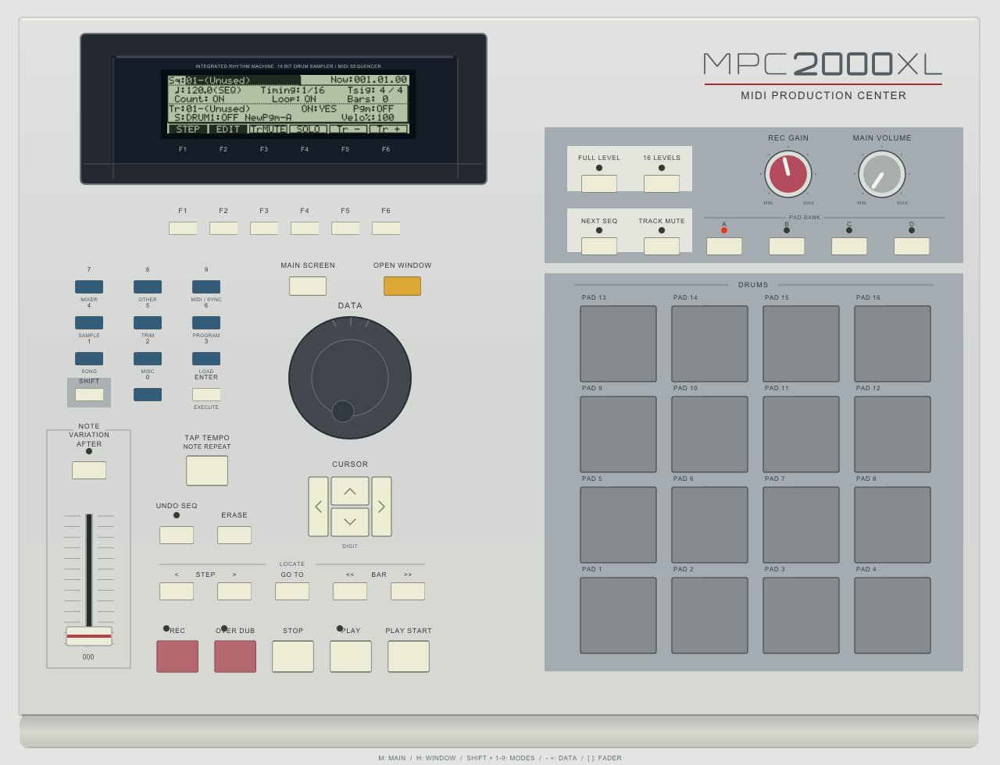

# DAVEY MPC2000XL: OS mods, patcher and emulator

**Built on the work of vubeatz ([github.com/dariuszchynek](https://github.com/dariuszchynek)).** This repo is a fork of his
[MPC2000XL emulator](https://github.com/dariuszchynek/mpc2000xl-emulator), and DAVEY OS starts from his MPC2000XL OS features
(tune ±360, transpose, mute groups, ALL param copy, LPF/HPF, input thru, format, double STOP, step move) and his
*MPC2000XL Updater*. His module data is included here **with his permission**, on his terms:

> **Free and open source, forever. Never sold, never charged for.** Credit vubeatz in anything you share or build on this.

What DAVEY adds: a waveform chop screen (16/8/4/LAZY → drum program), Program MONO (MONO pads choke each other),
TRIM pad select, Sampling Mode (SP1200/S900), a patcher app (macOS, Windows, browser) and an emulator test suite.
No Akai OS files are included; you need your own stock MPC2000XL OS 1.20. Builds are **emulator-tested**; always keep
the original OS on your card (LOAD it → DO IT restores the unit). User guide: [DAVEY_CHEAT_SHEET.md](DAVEY_CHEAT_SHEET.md).
Contributors and their AI agents: read [CLAUDE.md](CLAUDE.md) first.

Credits: **vubeatz / [dariuszchynek](https://github.com/dariuszchynek)**: the emulator this fork extends ([mpc2000xl-emulator](https://github.com/dariuszchynek/mpc2000xl-emulator), BSD-3),
the base OS features, the Updater and its module data · MAME and its authors (CPU, DSP and device models).

---

# MPC2000XL Emulator



An experimental MPC2000XL emulator derived from the MPC2000 Classic emulator,
with a separate MAME target: `mpc2000xldiag`.

The driver loads your **stock MPC2KXL.BIN, OS 1.20**, into the XL ROM map and
starts the V53A at its native reset vector. The guest boot ROM initializes the
machine and loads its own OS into RAM. The display renders guest LCD writes.
The panel has 16 pads, a Note Variation fader, separate banks A–D, Track Mute,
Next Sequence and guest-controlled LED outputs.

**Built and launched on macOS Apple Silicon with the stock XL 1.20 BIN.**
The native OS reached MAIN. Mouse Open Window, Next Sequence, Track Mute and
bank B in Track Mute were observed, including guest LED feedback; keyboard
MAIN/Open Window also responded. Loading/saving, audio and complete input
coverage remain unverified.
See [status](docs/STATUS.md) and [architecture](docs/ARCHITECTURE.md).

No firmware, panel ROM, disk image or sample library is included or downloaded.
This is an independent project, not an official Akai product.

## Build on macOS

Prerequisites: Xcode command-line tools, Python 3.9+, SDL2 and several GB of
free space. Install dependencies yourself if needed. When ready to build:

```bash
python3 tools/fetch_mame.py
SDL_INSTALL_ROOT="$(brew --prefix sdl2)" bash build_macos.sh
```

MAME is pinned by commit and archive SHA-256 in `mame.lock.json`. For an offline
download, use `python3 tools/fetch_mame.py --archive /path/to/pinned-mame.tar.gz`.
The XL build uses its own `vendor/` and `build/` directories and produces
`build/bin/mpc2000xldiag`, also wrapped as `build/MPC2000XL.app` for a separate
macOS app identity. Start through `run.py` or **Launch Emulator.command**, which
stage the ROM and panel paths. The source build is independent of other
emulator checkouts.
Set `SDL_INSTALL_ROOT` directly if SDL2 is installed without Homebrew.

## Launch on macOS or Windows

This build accepts the full **stock MPC2KXL.BIN, OS 1.20 (512 KiB)**.
A data floppy is optional. Classic EXE/SYS files do not work with this model.

See [firmware requirements and identity](docs/FIRMWARE.md). No firmware is
included or downloaded. Obtain files you are entitled to use independently.

**Prepare the emulator binary first** using the build instructions in this README.
The launch scripts do not install dependencies or compile the emulator.
Python 3.9+ is required on either platform. On Windows use the standard Python
installation with Tcl/Tk for the file picker; `py -3` or `python` must be available.

| Action | macOS | Windows |
| --- | --- | --- |
| Start with detected or saved files | `Launch Emulator.command` | `Launch Emulator.cmd` |
| Choose replacement system files and start | `Choose System and Launch.command` | `Choose System and Launch.cmd` |

### Put your files in the system folder

Place your own files next to [system/README.md](system/README.md):

```text
system/
  MPC2KXL.BIN
```

Double-click **Launch Emulator** for your platform. Names are case-insensitive.
The default order is: files in `system/`, existing remembered paths, then file
pickers for missing required inputs. A file with the right name but an unsupported identity is rejected.

Only `system/README.md` is public; all media in `system/` is ignored by Git.
The launcher never copies your originals into the public source files.
Paths chosen during a normal double-click launch are remembered in ignored
`config.local.json`. Use **Choose System and Launch** to bypass auto-detection
for that launch. Remove files from `system/` if you want remembered paths to take
precedence on subsequent normal launches.

### Use explicit paths or another folder

From a terminal in this project:

```bash
# macOS
python3 run.py --rom "/path/to/MPC2KXL.BIN" --remember
python3 run.py --system-dir "/path/to/my-system-folder" --remember
python3 run.py --choose --remember
```

```bat
rem Windows Command Prompt
py -3 run.py --rom "D:\My MPC files\MPC2KXL.BIN" --remember
py -3 run.py --system-dir "D:\My MPC files" --remember
py -3 run.py --choose --remember
```

A custom folder must contain the same standard filenames shown above.
Explicit file paths may use any names; content validation still applies.
Use quoted paths when they contain spaces. The same options can be passed to
`Launch Emulator.command` / `Launch Emulator.cmd`.

Select an optional data floppy with `--disk /path/to/data.hfe` or
`--choose-disk`. `--no-disk` ignores a saved floppy (`--remember` also saves that
choice). Optional disks are not auto-detected in `system/`.

Floppies must be HFE v1 or raw 1.44 MB IMG. The launcher validates the container,
not the filesystem or compatibility of its contents.
Each launch creates a private `run/session-*/` with copies of the input files.
Originals remain unchanged; guest disk saves stay in `media/floppy.hfe` or
`.img` within that session. To continue from disk changes, select that saved
image explicitly next time. CPU/RAM state is not restored between processes.

`--check` validates media and reports binary presence without running MAME;
it also works before compilation. `--prepare-only` creates session copies and
prints the command without executing it. `--binary` selects a compatible
custom SDL build; a stock MAME executable does not contain this project's target.
`--debug` enables private debugger/log output. After MAME's prototype warning,
the emulator now starts without a key press (the launcher sets MAME's debug flag with no debugger window, which skips its warning screen). **Audio remains disabled.**

## Windows build requirements

The Windows launch scripts and file picker are implemented, but **Windows
compilation and runtime have not been verified on a Windows host**.
They require the dedicated **SDL** target at `build/bin/mpc2000xldiag.exe`, plus its
matching runtime DLLs alongside it or on `PATH`. A macOS executable cannot be
used on Windows. No prebuilt Windows binary is included.

Follow the [upstream Windows build setup](https://docs.mamedev.org/initialsetup/compilingmame.html#microsoft-windows)
for an MSYS2 toolchain with Python, make and SDL2/SDL2_ttf. From that toolchain's
shell, the project-specific recipe is:

```bash
python3 tools/fetch_mame.py
python3 tools/integrate_mame.py
make -C vendor/mame -j4 SUBTARGET=mpc2000xldiag \
  SOURCES=src/mame/akai/mpc2000xldiag.cpp OSD=sdl USE_LIBSDL=1 \
  USE_QTDEBUG=0 NO_USE_PORTAUDIO=1 NO_USE_MIDI=1 NOWERROR=1 IGNORE_GIT=1
mkdir -p build/bin
cp vendor/mame/sdlmpc2000xldiag.exe build/bin/mpc2000xldiag.exe
```

The pinned archive contains symbolic links; native Windows Python may require
Developer Mode or permission to create them when fetching it. Keep the MSYS2
runtime DLL directory on `PATH`, or provide the matching dependencies beside
the executable. These are build instructions, not a claim of a Windows release.

## Controls and sources

[Controls](docs/CONTROLS.md) include keyboard mappings and mouse latching.
Click banks B/C/D, Track Mute or Next Seq on compact keyboards without F13–F17.
The panel uses the MPC2000XL control layout: display at upper left,
blue number keys, yellow Open Window, knobs and four banks above the pads.
Buttons and pads retain the Classic emulator's flat faces. LCD contents come
only from the OS.

| Path | Purpose |
| --- | --- |
| `src/mpc2000xldiag.cpp` | XL memory/devices, ROM loading, LCD and panel serial input |
| `run.py`, `tools/firmware.py` | File selection, validation and isolated sessions |
| `panel/` | Vector artwork/layout generation and mouse/fader input |
| `artwork/mpc2000xldiag/` | Ready-to-use panel assets |
| `tools/` | Pinned MAME fetch, integration and source audit |
| `docs/` | Firmware contract, architecture, controls and evidence boundaries |

Optional panel export on macOS: `python3 panel/make_panel_layout.py`.
It creates artwork/Lua only. Starting/building MAME does not regenerate artwork.

Project-authored files use [BSD-3-Clause](LICENSE); MAME as a whole uses GPL-2.0.
Preserve the upstream notices and read [THIRD_PARTY.md](THIRD_PARTY.md) before
distributing a binary. `PUBLIC_FILES.txt` lists the intended public source
files; `python3 tools/audit_public.py` checks that boundary.


## What can be published?

The intended source distribution is listed in `PUBLIC_FILES.txt`. It includes
project code, launchers, custom panel artwork, documentation, license notices
and the reviewed screenshot used in this README. The screenshot illustrates
the guest UI; it does not grant rights to redistribute the underlying firmware.

MAME-derived source retains its upstream BSD notices. MAME as a whole is
GPL-2.0 under the pinned `COPYING`; SDL2 uses the zlib license. These dependencies
do not prohibit a public source repository when their conditions are followed.
A compiled emulator must be distributed with the required notices and an
appropriate way to obtain its complete corresponding source, including our
modifications and build scripts. This project's BSD license alone does not
license the combined binary. See [THIRD_PARTY.md](THIRD_PARTY.md).

**Do not publish** AKAI OS/ROM/EXE/SYS files, disk images, third-party sample
libraries, private modifications, session media, RAM dumps, private logs or
`config.local.json`. Owning hardware or finding a download does not establish
permission to redistribute its software. `vendor/`, `build/`, `run/`, `local/`
and user media are excluded; do not upload a ZIP of the entire working folder.
No reference photograph, service manual or font file is included. Product names
and guest UI remain subject to their owners' rights; this project is independent.

Before publishing, run `python3 tools/audit_public.py`. For a source export made
only from `PUBLIC_FILES.txt`, run the audit with `--strict`. The audit detects
unexpected files, private paths, credential patterns, conversation residue and
binary payloads. The README image is hash-pinned and contains no textual or EXIF
metadata. Automated checks supplement manual review; they are not legal clearance.
